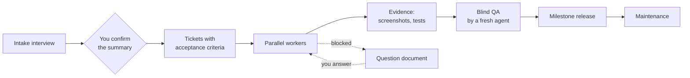

# Done Done

**Not "I'm done." Done done: built, tested, verified, delivered.**

English · [繁體中文](README.zh-TW.md)

Done Done is an Agent Skill for Codex, Claude Code and other agents that support skills. It runs large AI-built software projects like a small, disciplined team. Give it a goal, such as a company website, an internal system or a booking platform, and it works like this:

- It interviews you until the direction is clear.
- It breaks the work into tickets and runs the independent ones in parallel.
- It proves every result with evidence, and has an agent that never saw the work verify it.
- It keeps going until delivery.

When something needs your input, only the affected work waits; everything else keeps moving.

## Why

Autonomous coding agents handle single tasks well but become unreliable over a project that lasts days. They tend to fail in the same ways:

- **They build the wrong thing.** Requirements were never pinned down, and "any questions?" gets "no problems."
- **One blocker stops everything.** A single unanswered question leaves the whole run idle.
- **"Done" means "it compiled."** A passing build, an HTTP 200 or a self-review gets reported as a working feature.
- **Questions go missing.** Things only a colleague can answer end up buried in a log nobody reads.
- **Process eats the budget.** Review files and coordination messages grow faster than the product, and the context gets so large the agent forgets earlier decisions.
- **Leftovers pile up.** Test sites and temporary data accumulate, and nobody dares delete them.

Done Done turns each of these into an explicit rule, and backs the important ones with an automated checker.

## How it works



1. **Interview first.** The agent reads everything it can, then asks every question it needs, as early as possible. Each question comes with context and a recommended answer, in plain language. The interview ends with a one-page "Here's what I understand you want," and the agent does not run on its own until you confirm it. If it joins a project midway, it first checks the direction for gaps: unconfirmed assumptions, questions nobody passed on, rules read too strictly.
2. **Tickets, not tasks.** Each ticket is a behavior you can check yourself, such as "a customer picks a time slot and gets a confirmation email." Every acceptance criterion states the minimum evidence it needs.
3. **Parallel, like a company.** Independent tickets run at the same time, each worker in its own git worktree. How many depends on machine memory and API quota, and the checker lists which tickets can start together without touching the same resources. A worker that hits a question parks it and moves on to the next ticket.
4. **Evidence, then two-stage review.** There are six evidence levels, from *build* to *production*, and a lower level never stands in for a higher one. Anything shown on screen needs screenshots or recordings; text reports don't count. Work that touches money, data or permissions goes through two checks:
   - **Blind QA.** A fresh agent re-does the work. It gets only the acceptance criteria and a test environment, never the author's notes.
   - **Code review.** A second reader checks the diff for permission bypasses and data errors that never show up on screen.
5. **One question document.** Everything that needs a human goes into one file you answer in place:
   - questions for you, each with a ready-to-send reply;
   - questions for colleagues, each with a message you can forward as is;
   - outside conditions that can only be waited out.
6. **Clear stopping rules.** The agent stops in four cases only: everything is delivered, the deadline has passed, every remaining ticket is waiting on someone, or you say stop. When a milestone's due time arrives, it sends a status report and keeps working.
7. **Keeps going on its own.** With autopilot on, a stop hook sends the agent back to work whenever it tries to stop early. If the state stops changing, the hook lets it stop, so it doesn't burn your quota spinning. A runner script opens a fresh session for each round, so work continues after you close the laptop without the context growing.
8. **Learns as it goes.** Anything worth knowing next time, such as how to start the environment or a trap someone already fell into, goes into `LEARNINGS.md`. Every new ticket starts by reading it.
9. **Cleans up after itself.** Everything the agent creates is recorded. When the work is done, it is quarantined first and then removed under strict rules. Your data, the main and production sites, and restore backups are never touched.

## Design principles

- **State lives in files, not in the chat.** Any session can resume the work, and the context stays small enough to stay fast and cheap.
- **Evidence over claims.** A message saying "done" counts for nothing; the screenshot, test output or recording does.
- **The agent decides; you approve only what only you can approve.** Routine work, QA depth and cleanup are the agent's call. It asks you about direction, business facts and anything that changes production.
- **Plain language for people.** Reports, questions and milestone names contain no commit hashes, file paths or internal jargon.
- **Lean between agents, clear for people.** Hand-offs between agents stay under ten lines, with raw output saved to files rather than pasted. Only the reports you read are written out in full.
- **Every rule comes from a real failure.** 29 rules each trace back to a failure seen in a real project ([lessons](references/lessons.md)). 25 behavior scenarios check the skill itself after every change ([evals](evals/scenarios.md)).

## Quick start

Install the skill into your agent's skills directory:

```sh
# Codex
git clone https://github.com/owen4sure/done-done ~/.codex/skills/done-done
# Claude Code
git clone https://github.com/owen4sure/done-done ~/.claude/skills/done-done
```

Start a new project:

```text
Use done-done for this project: a company website with news, service pages and a contact form.
```

Or take over a project already in progress:

```text
Use done-done to continue this project.
```

## What you'll see

The agent keeps the project's state in `.done-done/`, as plain Markdown you can open and edit:

| File | What it holds |
|---|---|
| `GOAL.md` | Goal, deadline, milestones, what the agent may do on its own, confirmed decisions, and the "what I understand you want" summary |
| `QUESTIONS.md` | The question document: questions for you, questions to forward, and outside conditions. You write your answers directly in it |
| `tickets/*.md` | One file per ticket: what to build, acceptance criteria, evidence, hand-off notes |
| `LEARNINGS.md` | Things learned along the way (environment, test tricks, pitfalls), read before every ticket |
| `CREATED.md` | Test sites, temporary data and services the agent created, so they can be cleaned up safely |
| `LOG.md` | One line per event |

Status reports are six lines or fewer, written for someone who doesn't code (translated example):

```text
Done:      Customers can book a time slot and receive a confirmation email (T03, verified on screen)
Working:   Cancellations and refunds (T05), daily bookings view for staff (T06)
Blocked:   Refund rules, waiting on the store manager (Q1)
Remaining: 9 tickets; about 40 minutes each lately, roughly 6 hours to go (excluding waits)
You:       answer 2 questions and forward 1; reply "Approve a local test site; main site stays read-only" (Q2)
```

A question in the question document (translated example):

```markdown
## Q2 Refund rules for cancelled bookings
- Ask: Store manager
- Background: The system refunds deposits automatically, so it needs the rule. Refunds can't be finished until we know it.
- Question: How much is refunded for a cancellation one day ahead, and for one on the same day?
- Suggested: Full refund one day ahead, no refund on the same day (common practice; please confirm)
- Message to forward: Hi! The online booking site is almost ready. Could you confirm the refund rule ...
- Your answer:
```

## The state checker

A read-only checker, written in Python 3 with only the standard library, enforces the rules that matter most:

```sh
python3 scripts/check_state.py <project>          # status, ready tickets, what needs you
python3 scripts/check_state.py <project> --stop   # may the agent stop now?
python3 -B scripts/test_check_state.py            # run the tests
```

For unattended work, two optional helpers sit next to the checker:

```sh
python3 scripts/run_loop.py <project> --tool codex --rounds 5 -- --sandbox workspace-write   # a fresh session per round
python3 scripts/loop_hook.py                                                                  # stop hook and session-start reminder
```

Setup for Codex and Claude Code hooks is in [references/automation.md](references/automation.md).

It checks:

- **Tickets**: dependency cycles, and two tickets writing the same resource at once.
- **Evidence**: that every finished ticket has evidence at the required level, reviewed by someone other than the author; that on-screen evidence is a screenshot or recording; that work needing blind QA carries the verifier's own evidence.
- **Releases**: that a released version passed its integration check.
- **Questions**: that each question has background and a ready reply or forwardable message; that no answered question is still open; that nothing filed as an "external blocker" is really waiting on your approval.
- **Plain language**: no commit hashes, paths or common jargon in anything people read.
- **Cleanup and time**: leftovers that are due for cleanup, and the deadline down to the minute.
- **Parallel work**: which ready tickets can start together, and which must queue behind a resource conflict; whether money, data and permission changes had a code reviewer.

It does not judge whether the code is correct or the evidence genuine; blind QA covers that.

## When to use it

**A good fit:**

- Websites, web apps and internal systems built with AI agents over several days or sessions.
- Work where correctness matters: money, permissions, data migration.
- Projects with a deadline, where you want to step away and still understand progress at a glance.

**Not a fit:**

- Small fixes that take an hour or two. The process costs more than it saves.
- Open-ended exploration where the goal itself is still unknown.

## Good to know

- The skill text and templates are written in Traditional Chinese. Agents follow them regardless of the language you work in.
- The stop hook and the runner are optional and installed once. Hooks need to be trusted in Codex (`/hooks`) before they run. Every round of the runner uses quota, so set a round limit that fits your plan.
- Parallel work defaults to at most four workers and scales down when memory or quota runs low.

## Repository layout

```text
SKILL.md                  the workflow the agent follows
references/
  interview.md            intake interview and mid-project direction check
  parallel.md             dispatching, blind QA, hand-offs, recovery
  cleanup.md              what may be removed, how, and what never is
  automation.md           autopilot, stop hook, runner, session reminder
  release.md              milestone gates, deployment, final delivery
  lessons.md              the real failures behind each rule
templates/                GOAL, ticket, QUESTIONS, LEARNINGS, CREATED, hooks, AGENTS snippet
scripts/check_state.py    read-only state checker
scripts/loop_hook.py      stop hook and session-start reminder (Codex and Claude Code)
scripts/run_loop.py       runner that opens a fresh session each round
scripts/test_check_state.py  tests for all three
evals/scenarios.md        behavior scenarios for changing the skill
agents/openai.yaml        display metadata for Codex
```

## Contributing

Before you change the skill, run the scenarios in [evals/scenarios.md](evals/scenarios.md) with and without your change and compare how the agent behaves. Don't merge changes that lower the score. Keep `python3 -B scripts/test_check_state.py` passing.

## Acknowledgements

Done Done adapts ideas from [Matt Pocock's skills](https://github.com/mattpocock/skills) (MIT License):

- **grill-me / grilling** shaped the intake interview. The agent asks questions in rounds and gives a recommended answer for each. It looks up facts itself instead of asking you, and it does not act until you confirm a shared understanding.
- **to-tickets** shaped the tickets: vertical slices you can verify on their own, one file per ticket, each declaring what blocks it.

These skills were studied through [vinvcn's Simplified Chinese localization](https://github.com/vinvcn/mattpocock-skills-zh-CN) (MIT License).

It also borrows ideas from these projects:

- [Superpowers](https://github.com/obra/superpowers) (MIT): two-stage review (meets the spec, then code quality) and an isolated git worktree for each worker.
- [planning-with-files](https://github.com/OthmanAdi/planning-with-files) (MIT): a stop hook that won't let the agent quit with work left, and re-orienting the agent when a session starts.
- [Ralph](https://github.com/snarktank/ralph) (MIT): a loop that starts a fresh session each round and carries state only through files.
- [Compound Engineering](https://github.com/EveryInc/compound-engineering-plugin) (MIT): capturing what each piece of work taught so later work starts from it.
- [Get Shit Done](https://github.com/gsd-build/get-shit-done) (MIT): running independent work in waves and sizing tasks to fit a fresh context.
- [Caveman](https://github.com/JuliusBrussee/caveman) (Apache-2.0): keeping agent-to-agent messages short and not pasting raw output.

No files or text were copied from any of these projects; the ideas were rewritten in this skill's own words and adapted to its workflow.

The skill uses the Agent Skills format (`SKILL.md`), which Codex and Claude Code both support.

## License

[MIT](LICENSE)
