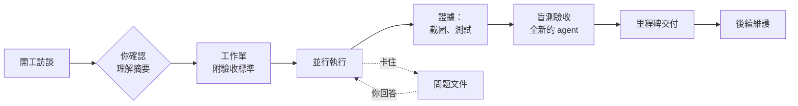

# Done Done

**不是「我做完了」，是真的完成：做好、測過、驗收過、交付了。**

[English](README.md) · 繁體中文

Done Done 是一個 Agent Skill，適用於 Codex、Claude Code 和其他支援 skill 的 agent，讓 AI agent 像一支有紀律的小團隊，把大型軟體專案做到交付。交給它一個目標，例如公司官網、內部系統或線上預約平台，它會這樣做：

- 先訪談你，直到方向完全清楚。
- 把工作拆成工作單，互不影響的同時做。
- 每個成果都要有證據，再交給一個完全沒參與的 agent 驗收。
- 一路推進到交付。

需要你回覆的事情出現時，只有受影響的部分會先停，其他工作照常進行。

## 為什麼需要它

AI coding agent 做單一任務很強，但一碰到要跑好幾天的專案就不穩，而且出錯的方式都差不多：

- **做錯方向**：需求從沒問清楚，問它「還有沒有問題」，它回答「沒問題」。
- **一個卡點，全部停擺**：一題沒人回答，整個專案就閒置。
- **「完成」其實只是「編譯過了」**：build 成功、網頁回應正常、自己審自己，就被回報成功能完成。
- **問題石沉大海**：只有同事知道答案的問題，埋在沒人會看的紀錄檔裡。
- **流程吃掉預算**：審查文件和協調訊息比產品長得還快；context 越來越大，前面的決定也忘了。
- **測試留下的東西越堆越多**：測試站、暫存資料到處都是，卻沒人敢刪。

Done Done 把這些問題逐一寫成明確的規則，最重要的幾條再由檢查程式自動把關。

## 怎麼運作



1. **先問清楚。** agent 先讀完所有能讀的資料，再把需要的問題一次問完，越早越好；每題都附背景和建議答案，用白話寫。訪談的最後，它會寫一頁「我理解你要的」，你確認之後它才開始自己跑。如果是中途接手的專案，它會先檢查方向有沒有缺口：自己假設卻沒確認過的事、沒有轉達出去的問題、把規則解讀得太嚴格的地方。
2. **工作單，而不是待辦清單。** 每張工作單都是你能自己確認的一件事，例如「顧客選好時段後，會收到確認信」。每條驗收標準都寫明至少需要哪一級的證據。
3. **像公司一樣並行。** 互不影響的工作同時做，每個執行者在自己的 git worktree 裡工作。同時開幾個，看電腦記憶體和 API 額度決定；檢查程式會列出哪些工作單彼此不衝突、可以一起開工。執行者遇到問題，就把問題留下、換下一張工作單繼續做。
4. **先有證據，再兩關驗收。** 證據分六級，從「能編譯」到「正式站實測」，低等級不能代替高等級。畫面上的成果要附截圖或錄影，文字報告不算。動到錢、資料、權限的工作要過兩關：
   - **盲測**：一個全新的 agent 重做一遍。它只拿到驗收標準和測試環境，看不到作者的任何說明。
   - **程式碼審查**：另外有人看程式改動，抓出畫面上看不到的權限漏洞和資料錯誤。
5. **一份問題文件。** 所有需要人處理的事，都集中在同一份文件，你直接在文件裡回答：
   - 要問你的：附上照抄就能回的一句話。
   - 要問同事的：附上可以直接轉傳的訊息。
   - 只能等的外部狀況。
6. **停止條件很明確。** 只有四種情況會停：全部交付完成、過了截止時間、剩下的工作都在等人回覆、你喊停。里程碑到了預定時間，它會先交一份現況報告，然後繼續做。
7. **自己持續推進。** 開啟自動模式後，agent 想提早停下時，停止閘門會把它拉回去繼續做；狀態一直沒變化才放行，不會空轉燒額度。另外有一支續跑程式，每一輪都開全新的 session 接著做，你關掉電腦後工作還能繼續，context 也不會越來越大。
8. **越做越聰明。** 下次還用得到的事，例如環境怎麼啟動、哪裡有坑，都記在 `LEARNINGS.md`，每張工作單開工前先讀。
9. **用完自己收拾。** agent 建立的每樣東西都有紀錄，用完先隔離、再依照嚴格標準刪除。你的資料、主站、正式站和還原用的備份，一律不碰。

## 設計原則

- **狀態存在檔案裡，不放在對話裡。** 任何 session 都能接手，context 保持精簡，速度快、成本低。
- **證據勝過宣稱。** 一句「做完了」不算數；截圖、測試輸出、錄影才算。
- **agent 自己判斷，你只處理只有你能決定的事。** 例行工作、驗收深度、清理，由 agent 判斷；方向、業務事實和任何會改到正式站的動作，才會問你。
- **給人看的一律白話。** 報告、問題文件、里程碑名稱裡，不出現版本號、檔案路徑或內部術語。
- **agent 之間精簡，給人看的清楚。** agent 之間的派工和交接 10 行內講完，長的輸出存成檔案、不整段貼；只有給你看的報告才完整寫清楚。
- **每條規則都來自真實的失敗。** 29 條規則都對應到真實專案裡發生過的問題（[事故紀錄](references/lessons.md)）；每次修改 skill，都用 25 個行為評估情境檢查一次（[評估情境](evals/scenarios.md)）。

## 快速開始

把 skill 裝進 agent 的 skills 目錄：

```sh
# Codex
git clone https://github.com/owen4sure/done-done ~/.codex/skills/done-done
# Claude Code
git clone https://github.com/owen4sure/done-done ~/.claude/skills/done-done
```

開始一個新專案：

```text
使用 done-done 做這個專案：公司官網，要有最新消息、服務介紹和聯絡表單。
```

或接手一個做到一半的專案：

```text
使用 done-done 接續這個專案。
```

## 你會看到什麼

agent 會把專案狀態放在 `.done-done/` 資料夾，都是可以直接打開、修改的 Markdown：

| 檔案 | 內容 |
|---|---|
| `GOAL.md` | 目標、截止時間、里程碑、可以自己做的事、已確認的決定，以及「我理解你要的」 |
| `QUESTIONS.md` | 問題文件：要問你的、要你轉問的、外部狀況；你直接在裡面填答案 |
| `tickets/*.md` | 一張工作單一個檔：要做什麼、驗收標準、證據、交接紀錄 |
| `LEARNINGS.md` | 一路上學到的事（環境、測試技巧、踩過的坑），每張工作單開工前先讀 |
| `CREATED.md` | agent 建立的測試站、暫存資料和服務，方便之後安全清理 |
| `LOG.md` | 事件紀錄，一行一件 |

回報不超過六行，寫給不寫程式的人看：

```text
完成：顧客可以在預約頁選時段並收到確認信（T03，畫面實測）
進行中：取消預約與退款（T05）、後台每日預約表（T06）
卡住：退款規則要等店長回答（Q1）
剩餘：9 張；最近每張平均約 40 分鐘，估計還要 6 小時（不含等待）
需要你：回答 2 題、轉問店長 1 題；照抄回覆「同意開本機測試站，主站不寫入」（Q2）
```

問題文件裡的一題：

```markdown
## Q2 取消預約的退款規則
- 對象: 店長
- 背景: 顧客取消預約時，系統要照規則自動退訂金；不知道規則，退款功能就做不完
- 問題: 前一天取消和當天取消，各退多少？
- 建議: 前一天取消全額退，當天取消不退（常見做法，請店長確認）
- 轉傳內容: 店長好，網站的線上預約快做好了，想確認取消預約的退款規則……
- 你的回答:
```

## 狀態檢查程式

附一支唯讀的檢查程式，用 Python 3 寫成，只用標準函式庫，負責把最重要的規則守住：

```sh
python3 scripts/check_state.py <專案>          # 目前狀態、可以做的工作單、需要你做的事
python3 scripts/check_state.py <專案> --stop   # 現在可以停嗎？
python3 -B scripts/test_check_state.py         # 跑測試
```

要無人值守時，旁邊還有兩支選用的小工具：

```sh
python3 scripts/run_loop.py <專案> --tool codex --rounds 5 -- --sandbox workspace-write   # 每輪開新 session 續跑
python3 scripts/loop_hook.py                                                               # 停止閘門與接手提醒
```

Codex 和 Claude Code 的 hook 設定方式見 [references/automation.md](references/automation.md)。

它會檢查：

- **工作單**：依賴有沒有繞成一圈；兩張工作單有沒有同時寫同一個資源。
- **證據**：完成的工作是否有足夠等級的證據，並由作者以外的人驗收；畫面證據是不是截圖或錄影；需要盲測的工作，有沒有驗收者自己留的證據。
- **發布**：發布的版本是否做過整合驗收。
- **問題文件**：每題有沒有背景、照抄就能回的句子或可以轉傳的訊息；有沒有已經回答卻還沒處理的題目；有沒有其實在等你同意、卻被當成外部阻礙的事。
- **白話**：給人看的文字裡有沒有版本號、路徑或常見術語。
- **清理與時間**：哪些測試物該清理了，以及精確到分鐘的截止時間。
- **並行**：哪些工作單可以一起開工、哪些因為資源衝突要排隊；動到錢、資料、權限的工作有沒有經過程式碼審查。

它不判斷程式寫得對不對、證據是不是真的；這部分交給盲測驗收。

## 適合什麼專案

**適合：**

- 用 AI agent 開發、要跨好幾天或好幾個 session 的網站、網頁應用與內部系統。
- 正確性很重要的工作：金額、權限、資料搬移。
- 有截止時間、你希望放手讓它跑、又能隨時看懂進度的專案。

**不適合：**

- 一兩個小時就能做完的小修改，花在流程上的成本比省下的多。
- 連目標都還不確定的探索型工作。

## 使用須知

- skill 內容和範本以繁體中文撰寫，不論你用什麼語言工作，agent 都能照著做。
- 停止閘門和續跑程式是選用的，裝一次就好。Codex 的 hook 要先在 `/hooks` 裡按信任才會執行。續跑的每一輪都會用掉額度，請依你的方案設定輪數上限。
- 並行預設最多 4 個執行者，記憶體或額度吃緊時會自動減少。

## 檔案結構

```text
SKILL.md                  agent 依循的完整流程
references/
  interview.md            開工訪談與中途接手的方向檢查
  parallel.md             派工、盲測驗收、交接、當機恢復
  cleanup.md              哪些可以清、怎麼清、什麼絕對不能刪
  automation.md           自動模式、停止閘門、續跑程式、接手提醒
  release.md              里程碑關卡、部署、最終交付
  lessons.md              每條規則背後的真實事故
templates/                GOAL、工作單、問題文件、經驗檔、建立物清單、hook 設定、AGENTS 片段
scripts/check_state.py    唯讀狀態檢查程式
scripts/loop_hook.py      停止閘門與接手提醒（Codex、Claude Code 共用）
scripts/run_loop.py       每輪開新 session 的續跑程式
scripts/test_check_state.py  上面三支的測試
evals/scenarios.md        修改 skill 時用的行為評估情境
agents/openai.yaml        Codex 的顯示設定
```

## 參與貢獻

修改 skill 之前，先用 [evals/scenarios.md](evals/scenarios.md) 的情境，在改動前和改動後各跑一次，比較 agent 的行為；分數下降的修改不要合併。也請確認 `python3 -B scripts/test_check_state.py` 全部通過。

## 致謝

Done Done 參考了 [Matt Pocock 的 skills](https://github.com/mattpocock/skills)（MIT 授權）的做法：

- **grill-me／grilling**：開工訪談的方式參考它。agent 一輪一輪提問，每題附上建議答案；查得到的事實自己查，不拿來問使用者；使用者確認雙方理解一致之前，不動手。
- **to-tickets**：工作單的拆法參考它。每張都是能獨立驗證的垂直切片，一張一個檔，並寫明被哪些工作擋住。

研讀這些 skill 時使用的是 [vinvcn 的簡體中文版](https://github.com/vinvcn/mattpocock-skills-zh-CN)（MIT 授權）。

另外也參考了這些專案的做法：

- [Superpowers](https://github.com/obra/superpowers)（MIT）：兩關驗收（先看符不符合規格，再看程式品質），以及每個執行者用獨立的 git worktree。
- [planning-with-files](https://github.com/OthmanAdi/planning-with-files)（MIT）：還有工作沒做完就不讓 agent 停下的停止閘門，以及新 session 開始時的接手提醒。
- [Ralph](https://github.com/snarktank/ralph)（MIT）：每一輪開全新 session、只靠檔案接續的續跑方式。
- [Compound Engineering](https://github.com/EveryInc/compound-engineering-plugin)（MIT）：把每次工作學到的經驗記下來，讓之後的工作從這些經驗出發。
- [Get Shit Done](https://github.com/gsd-build/get-shit-done)（MIT）：把互不影響的工作分批並行，工作切到一個全新 context 就做得完的大小。
- [Caveman](https://github.com/JuliusBrussee/caveman)（Apache-2.0）：agent 之間的訊息寫短，不整段貼原始輸出。

本專案沒有從上述任何專案複製檔案或文字，都是用自己的寫法重新撰寫，並配合本 skill 的流程調整。

本 skill 採用 Agent Skills 格式（`SKILL.md`），Codex 和 Claude Code 都支援。

## 授權

[MIT](LICENSE)
